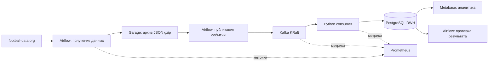

# Football Data Stack

[](https://github.com/15683/data-stack/actions/workflows/ci.yml)

Учебный проект на стыке **Data Engineering и DevOps**: полный путь футбольных данных
от внешнего API до аналитических витрин, с развёртыванием в Kubernetes,
проверками качества загрузки, мониторингом и резервным копированием.

Проект работает на одной виртуальной машине: **Ubuntu Server 22.04 · 4 vCPU · 8 ГБ RAM · 80 ГБ SSD**.

## Задача и результат

Данные о матчах поступают из football-data.org. Система сохраняет исходные ответы,
обрабатывает новые и изменённые результаты и формирует SQL-витрины для Metabase:
матчи, забитые и пропущенные голы, победы, ничьи и поражения команд по сезонам.

Отдельная витрина показывает результат каждой загрузки: сколько событий ожидалось,
сколько обработано и сколько отклонено. Данные можно повторно загрузить из архива
или получить за пропущенный период без создания дубликатов матчей.

## Архитектура



DAG `football_ingestion` выполняет три задачи: `snapshot → publish → verify`.
Последняя задача проверяет завершение обработки в DWH. Получение данных из API
выполняется по расписанию; Kafka отделяет публикацию событий от их обработки.

| Компонент | Назначение |
|---|---|
| Apache Airflow 3 | Расписание, повторные попытки и проверка загрузки |
| Garage | S3-совместимый архив исходных ответов для replay |
| Apache Kafka в режиме KRaft | Доставка событий и отдельный топик для отклонённых сообщений |
| Python, psycopg, PostgreSQL | Проверка событий, загрузка без дублей и SQL-витрины |
| Metabase | Анализ матчей и результатов команд |
| k3s, Helm, Docker | Развёртывание, конфигурация и сборка контейнеров |
| Prometheus, GitHub Actions | Мониторинг, автоматические проверки и публикация образов |

PostgreSQL разделён на два экземпляра: DWH и служебные БД приложений.
Версии и параметры компонентов закреплены в [Helm chart](deploy/chart/values.yaml) и [Dockerfile](docker/).

## Инженерные решения

- **Повторная обработка:** доставка at-least-once, дедупликация событий и обновление
  матчей по идентификатору с учётом времени изменения источника.
- **Контроль результата:** учёт обработанных и отклонённых событий; пустой ответ API
  отличается от незавершённой или ошибочной загрузки.
- **Восстановление данных:** replay из Garage, backfill по диапазону дат и SQL-миграции.
- **Эксплуатация:** readiness/liveness probes, метрики и alert rules, ограничения ресурсов
  и сроков хранения, проверка восстановления DWH из дампа.
- **Разграничение доступа:** Kubernetes Secrets, NetworkPolicy и отдельная роль
  PostgreSQL только для чтения из Metabase.

Причины выбора компонентов и гарантии обработки описаны в [архитектуре](docs/architecture.md)
и [ADR](docs/adr/001-small-stack.md).

## Проверки и воспроизводимость

CI выполняет **36 модульных и 8 интеграционных тестов**, проверяет Helm-манифесты,
конфигурацию Prometheus и StatsD, импорт DAG и запуск Airflow API. Перед публикацией
контейнеры проходят проверку зависимостей и сканирование Trivy.

На локальном стенде проверены replay и backfill: **18 матчей обработаны без дублей**.
Восстановление во временную БД подтвердило наличие матчей, миграций и сезонной витрины.
Это функциональные проверки на небольшом наборе данных, а не нагрузочный тест.

Для воспроизводимого знакомства есть отдельный **demo-режим без API-токена**:
3 синтетических матча, повторная доставка и исправление счёта. Ожидаемый итог —
3 матча и 9 голов. [Инструкция demo](docs/local-start.md).

## Запуск

Подготовьте VM, Docker, Helm и k3s по [инструкции локального запуска](docs/local-start.md).
Для первого запуска из корня клонированного репозитория:

```bash
mkdir -p "$HOME/.config/data-stack"
cp deploy/local.env.example "$HOME/.config/data-stack/local.env"
make doctor
make build
make import-images
make deploy
make status
```

Токен football-data.org запрашивается при первом live-развёртывании.
После запуска включите DAG в Airflow; параметр `raw_key` оставьте пустым для нового
запроса API. Настройка Metabase и готовые SQL-запросы — в [инструкции по аналитике](docs/metabase.md).

## Разработка и доставка изменений

**Локальные изменения → проверки → push / pull request → GitHub Actions → развёртывание.**

- В pull request CI проверяет код и собирает образы.
- Push в `main` запускает CI и публикует прошедшие проверки образы в GHCR с тегом SHA коммита.
- Рабочая VM обновляется отдельно: локально через `make build`, `make import-images`,
  `make deploy` либо через ручной CD workflow после настройки сети и SSH.
- Полная проверка чистой установки k3s вынесена в отдельный ручной workflow.

**Push не обновляет рабочий стенд автоматически.** [Настройка GitHub Actions](docs/ci-cd.md).

## Границы проекта

Один узел k3s и по одной реплике сервисов: отказоустойчивость уровня HA не реализована.
Доступность истории матчей зависит от тарифа API. Backup на диске VM требует отдельной
копии вне VM. Live и demo следует запускать на разных стендах, чтобы уложиться в 8 ГБ RAM.

## Документация

[Запуск и обновление](docs/local-start.md) · [Контракт данных](docs/data-contract.md) ·
[Эксплуатация и backup](docs/operations.md) · [Ресурсы и измерения](docs/resources.md) ·
[Устранение ошибок](docs/troubleshooting.md) · [Учебные сценарии](docs/exercises.md) ·
[История изменений](CHANGELOG.md)

Код распространяется по лицензии [MIT](LICENSE). Demo-данные синтетические;
использование реальных данных регулируется условиями football-data.org.
