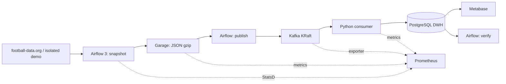

# Football Data Stack

Учебный проект **Data Engineering + DevOps**: получение футбольных матчей,
сохранение raw, доставка событий, идемпотентная загрузка и аналитика.
Один узел **Ubuntu Server 22.04 · 4 vCPU · 8 GiB RAM · 80 GB SSD**.



**Что демонстрирует проект:** повторную доставку без дублей, replay из raw,
DLQ, обработку поздних изменений, SQL-миграции, проверки восстановления,
ограничения ресурсов Kubernetes и проверку сборок в GitHub Actions.

## Быстрый старт

Подготовьте Docker, Helm 3 и k3s по [инструкции локального запуска](docs/local-start.md).
Из корня проекта:

```bash
mkdir -p "$HOME/.config/data-stack"
cp deploy/local.env.example "$HOME/.config/data-stack/local.env"
make doctor
make build
make import-images
make deploy
make status
```

Ссылки на образы сохраняются между терминалами. При первом live-запуске скрипт
запросит токен football-data.org. Для **demo без токена** задайте в local.env
`SOURCE_MODE=demo` и `NAMESPACE=data-stack-demo`, затем `make deploy` и `make demo`.
Demo и live запускаются на отдельных стендах; два полных стека не рассчитаны на одну VM 8 GiB.

Demo создаёт 3 синтетических матча, повторяет доставку и исправляет счёт: итог —
3 матча, 3 команды, 9 голов, без дубликатов. [Дашборд и SQL](docs/metabase.md).
Для Windows есть один [PowerShell launcher](scripts/open-ui.ps1) с локальной конфигурацией.

## Как понять результат

DAG `football_ingestion`: `snapshot → publish → verify`. XCom задачи verify содержит
expected_count, processed_count, rejected_count и статус. `empty` означает корректный
пустой ответ API, `completed` — успешную обработку. Ошибки DLQ не скрываются зелёным
статусом публикации. Короткое окно CL может не содержать матчей — используйте даты,
сезон или воспроизводимый demo.

```bash
make backfill ARGS='--date-from 2026-09-01 --date-to 2026-09-26 --season 2026 --batch-id september'
```

Повтор batch-id использует сохранённый raw; новый ID нужен для свежего запроса API.
Глубина истории зависит от тарифа источника. Catchup выключен: после долгого простоя
период восстанавливается явно через backfill.

## Стек и ограничения

| Компонент | Версия / режим |
|---|---|
| k3s | v1.35.5+k3s1, один узел |
| Airflow | 3.3.2, Python 3.12, LocalExecutor, одна задача |
| Garage | 2.3.0, одна реплика |
| Kafka | 4.3.0, KRaft, одна partition |
| PostgreSQL | 16.14, отдельно DWH и метаданные приложений |
| Metabase | 0.63.18 |
| Prometheus | 3.15.0, без Grafana |

Это лаборатория, не HA-кластер. Публикация API пакетная по расписанию, а не CDC.
Постоянные memory limits суммарно 6048 MiB; PVC запрашивают 37 GiB.
local-path не ограничивает фактический размер данных. [Бюджет и измерения](docs/resources.md).
Backup на том же диске не защищает от потери VM; предусмотрены экспорт и restore-check.

## Документация

| Задача | Инструкция |
|---|---|
| Первый запуск, обновление, доступ из Windows | [Local start](docs/local-start.md) |
| Гарантии доставки и причины выбора компонентов | [Architecture](docs/architecture.md), [ADR](docs/adr/001-small-stack.md) |
| Формат событий и совместимость | [Data contract](docs/data-contract.md) |
| Метрики, replay, backup и restore | [Operations](docs/operations.md) |
| Проблемы запуска | [Troubleshooting](docs/troubleshooting.md) |
| Витрины и дашборд | [Metabase](docs/metabase.md) |
| Упражнения с отказами | [Exercises](docs/exercises.md) |
| GitHub Actions и ограничения CD | [CI/CD](docs/ci-cd.md) |
| Изменения | [Changelog](CHANGELOG.md) |

## Проверки

```bash
python3.12 -m venv .venv
source .venv/bin/activate
pip install -r requirements-dev.txt
make lint test
bash scripts/integration.sh
python scripts/check_statsd.py
bash scripts/validate-manifests.sh
```

Тесты не требуют настоящего API-токена. Полная проверка k3s — отдельный ручной
workflow `acceptance.yml`; обычный CI проверяет и публикует образы, CD необязателен.
Новые SQL-изменения добавляйте следующей миграцией, уже применённые файлы не редактируйте.

Лицензия кода: [MIT](LICENSE). Demo-данные синтетические; реальные данные API
используются согласно условиям источника и не включаются в репозиторий.
