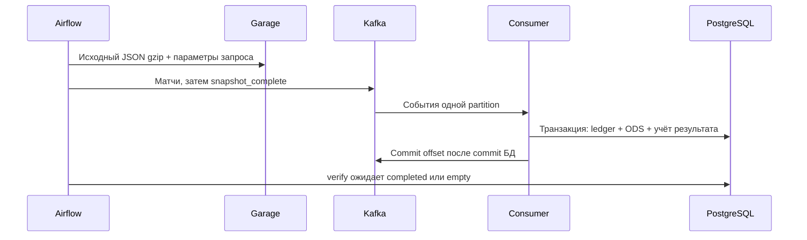

# Архитектура и границы гарантий

Источник опрашивается по расписанию: это пакетное получение данных с событийной
доставкой, а не поток изменений из API в реальном времени.

Kafka здесь нужна для изучения offsets, повторной доставки и независимого consumer.
При отключённом consumer Airflow может закончить publish, но verify завершится
по таймауту. Возврат consumer догружает события; проверку можно повторить.
Одна partition сохраняет порядок завершения снимка; увеличение partitions требует
другого протокола завершения. `acks=all` при replication factor 1 не означает HA.

Raw сохраняется до публикации. Retry того же run_id и окна использует тот же файл.
Kafka delivery — at-least-once. Уникальный event_id и транзакция PostgreSQL дают
идемпотентный результат. Новая версия матча определяется парой lastUpdated/fetched_at;
поздно пришедшая старая версия не заменит новую.

Подтверждённый DLQ предшествует commit offset. Для валидного envelope сохраняется
rejected event; после исправления обработчика replay переводит его в processed.
Если envelope повреждён, событие не связывается с произвольной загрузкой: отсутствие
ожидаемых событий обнаруживается при завершении снимка.

processed_count — число уникальных валидных событий, а не число INSERT в ODS.
Матч мог уже существовать или иметь более новую версию. История результатов
сохраняется; подробный ledger очищается через 90 дней. Raw хранится 30 дней.

LocalExecutor выполняет одну задачу; Redis, Celery и triggerer не используются.
Два PostgreSQL отделяют метаданные Airflow/Metabase от DWH. SQL-миграции применяются
под advisory lock с проверкой checksum. Откат образа не откатывает схему БД.

NetworkPolicy ограничивает входящие соединения по компонентам; egress оставлен
для DNS, Kubernetes API, registry и внешнего источника. UI доступны через SSH.
SimpleAuth предназначен для учебного стенда. Одна VM, local-path и одна реплика
не обеспечивают доступность при отказе диска или узла.
